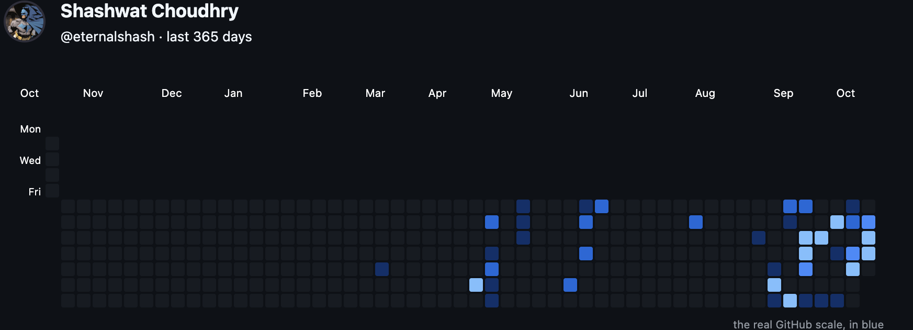

 

<!-- Custom GitColors Contribution Graph -->
<a href="https://github.com/eternalshash">
  <picture>
    <source media="(prefers-color-scheme: dark)" srcset="https://gitcolors.vercel.app/api/svg?username=eternalshash&preset=githubblue&emptyColor=filled&animate=true&mode=levels&theme=dark" />
    <source media="(prefers-color-scheme: light)" srcset="https://gitcolors.vercel.app/api/svg?username=eternalshash&preset=githubblue&emptyColor=filled&animate=true&mode=levels&theme=light" />
    
  </picture>
</a>

 

---

  

  

  Configured with <a href="https://gitcolors.vercel.app">gitcolors</a> | Generated for <a href="https://github.com/eternalshash">@eternalshash</a>

